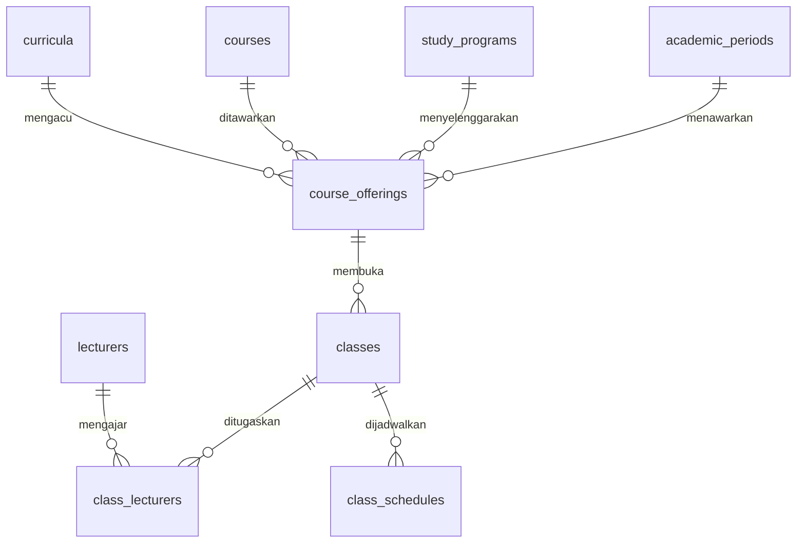

# Dokumentasi Basis Data: Penawaran Kelas dan Jadwal Perkuliahan (Fase 08)

## 1. Ringkasan Skema

Modul Penawaran Kelas dan Jadwal Perkuliahan menambahkan 5 tabel relasional baru pada skema PostgreSQL:
1. `academic_periods`: Master periode/semester akademik perguruan tinggi.
2. `course_offerings`: Penawaran mata kuliah per periode akademik dan program studi.
3. `classes`: Kelas perkuliahan yang dibuka untuk suatu penawaran mata kuliah.
4. `class_lecturers`: Penugasan dosen pengajar (koordinator maupun *team teaching*) pada kelas perkuliahan.
5. `class_schedules`: Jadwal pelaksanaan perkuliahan (hari, jam mulai, jam selesai, ruang, dan moda pengajaran).

File migrasi:
- `migrations/000005_create_classes_and_schedules_tables.up.sql`
- `migrations/000005_create_classes_and_schedules_tables.down.sql`

---

## 2. Definisi Tabel dan Struktur Relasi

### 2.1. Tabel `academic_periods`
Menyimpan periode akademik atau semester perkuliahan formal.

| Kolom | Tipe | Constraint | Deskripsi |
|---|---|---|---|
| `id` | UUID | PRIMARY KEY, DEFAULT `gen_random_uuid()` | Pengenal unik periode |
| `code` | VARCHAR(20) | NOT NULL, UNIQUE | Kode periode (contoh: `20241`, `20242`) |
| `name` | VARCHAR(100) | NOT NULL | Nama periode (contoh: `Semester Ganjil 2024/2025`) |
| `semester_type` | VARCHAR(20) | NOT NULL, CHECK (`semester_type IN ('ODD', 'EVEN', 'SHORT')`) | Jenis semester |
| `start_date` | DATE | NOT NULL | Tanggal awal periode |
| `end_date` | DATE | NOT NULL | Tanggal akhir periode (`CHECK (start_date <= end_date)`) |
| `is_active` | BOOLEAN | NOT NULL, DEFAULT `false` | Status keaktifan periode untuk operasional berjalan |
| `created_at` | TIMESTAMPTZ | NOT NULL, DEFAULT `NOW()` | Waktu pembuatan |
| `updated_at` | TIMESTAMPTZ | NOT NULL, DEFAULT `NOW()` | Waktu pembaruan |

**Indeks:**
- `idx_academic_periods_code`: UNIQUE (`code`)
- `idx_academic_periods_is_active`: B-Tree (`is_active`)
- `idx_academic_periods_dates`: B-Tree (`start_date`, `end_date`)

---

### 2.2. Tabel `course_offerings`
Menghubungkan mata kuliah dengan periode akademik dan program studi penyelenggara.

| Kolom | Tipe | Constraint | Deskripsi |
|---|---|---|---|
| `id` | UUID | PRIMARY KEY, DEFAULT `gen_random_uuid()` | Pengenal unik penawaran |
| `academic_period_id` | UUID | NOT NULL, FK -> `academic_periods(id)` ON DELETE RESTRICT | Periode akademik penawaran |
| `course_id` | UUID | NOT NULL, FK -> `courses(id)` ON DELETE RESTRICT | Mata kuliah yang ditawarkan |
| `curriculum_id` | UUID | NULL, FK -> `curricula(id)` ON DELETE RESTRICT | Kurikulum acuan (opsional) |
| `study_program_id` | UUID | NOT NULL, FK -> `study_programs(id)` ON DELETE RESTRICT | Program studi penyelenggara |
| `status` | VARCHAR(20) | NOT NULL, DEFAULT `'PLANNED'`, CHECK (`status IN ('PLANNED', 'OPEN', 'CLOSED', 'CANCELLED')`) | Status penawaran mata kuliah |
| `created_at` | TIMESTAMPTZ | NOT NULL, DEFAULT `NOW()` | Waktu pembuatan |
| `updated_at` | TIMESTAMPTZ | NOT NULL, DEFAULT `NOW()` | Waktu pembaruan |

**Constraint Tambahan:**
- `uq_course_offerings_period_course_prodi`: `UNIQUE (academic_period_id, course_id, study_program_id)` (mencegah duplikasi penawaran mata kuliah yang sama di periode dan prodi yang sama).

**Indeks:**
- `idx_course_offerings_period_id`: B-Tree (`academic_period_id`)
- `idx_course_offerings_course_id`: B-Tree (`course_id`)
- `idx_course_offerings_curriculum_id`: B-Tree (`curriculum_id`)
- `idx_course_offerings_study_program_id`: B-Tree (`study_program_id`)
- `idx_course_offerings_status`: B-Tree (`status`)

---

### 2.3. Tabel `classes`
Unit pelaksanaan perkuliahan (kelompok kelas) untuk suatu penawaran mata kuliah.

| Kolom | Tipe | Constraint | Deskripsi |
|---|---|---|---|
| `id` | UUID | PRIMARY KEY, DEFAULT `gen_random_uuid()` | Pengenal unik kelas |
| `course_offering_id` | UUID | NOT NULL, FK -> `course_offerings(id)` ON DELETE RESTRICT | Referensi penawaran mata kuliah |
| `code` | VARCHAR(20) | NOT NULL | Kode/kelompok kelas (e.g. `A`, `B`, `K01`) |
| `name` | VARCHAR(100) | NOT NULL | Nama kelas (e.g. `Kelas A - Reguler Pagi`) |
| `capacity` | INT | NOT NULL, CHECK (`capacity > 0`) | Daya tampung mahasiswa |
| `status` | VARCHAR(20) | NOT NULL, DEFAULT `'DRAFT'`, CHECK (`status IN ('DRAFT', 'OPEN', 'IN_PROGRESS', 'CLOSED', 'CANCELLED')`) | Lifecycle status kelas |
| `remarks` | TEXT | NULL | Catatan tambahan |
| `created_at` | TIMESTAMPTZ | NOT NULL, DEFAULT `NOW()` | Waktu pembuatan |
| `updated_at` | TIMESTAMPTZ | NOT NULL, DEFAULT `NOW()` | Waktu pembaruan |

**Constraint Tambahan:**
- `uq_classes_offering_code`: `UNIQUE (course_offering_id, code)` (mencegah duplikasi kode kelas di bawah satu penawaran).

**Indeks:**
- `idx_classes_offering_id`: B-Tree (`course_offering_id`)
- `idx_classes_code`: B-Tree (`code`)
- `idx_classes_status`: B-Tree (`status`)

---

### 2.4. Tabel `class_lecturers`
Penugasan dosen pengajar pada kelas perkuliahan.

| Kolom | Tipe | Constraint | Deskripsi |
|---|---|---|---|
| `id` | UUID | PRIMARY KEY, DEFAULT `gen_random_uuid()` | Pengenal relasi penugasan |
| `class_id` | UUID | NOT NULL, FK -> `classes(id)` ON DELETE RESTRICT | Kelas perkuliahan |
| `lecturer_id` | UUID | NOT NULL, FK -> `lecturers(id)` ON DELETE RESTRICT | Dosen yang ditugaskan |
| `role` | VARCHAR(30) | NOT NULL, DEFAULT `'COORDINATOR'`, CHECK (`role IN ('COORDINATOR', 'TEAM_TEACHING')`) | Peran dosen pengajar |
| `status` | VARCHAR(20) | NOT NULL, DEFAULT `'ACTIVE'`, CHECK (`status IN ('ACTIVE', 'INACTIVE')`) | Status keaktifan penugasan |
| `created_at` | TIMESTAMPTZ | NOT NULL, DEFAULT `NOW()` | Waktu penugasan |
| `updated_at` | TIMESTAMPTZ | NOT NULL, DEFAULT `NOW()` | Waktu pembaruan |

**Constraint Tambahan:**
- `uq_class_lecturers`: `UNIQUE (class_id, lecturer_id)` (mencegah duplikasi penugasan dosen yang sama pada kelas yang sama).

**Indeks:**
- `idx_class_lecturers_class_id`: B-Tree (`class_id`)
- `idx_class_lecturers_lecturer_id`: B-Tree (`lecturer_id`)

---

### 2.5. Tabel `class_schedules`
Jadwal waktu perkuliahan mingguan per kelas.

| Kolom | Tipe | Constraint | Deskripsi |
|---|---|---|---|
| `id` | UUID | PRIMARY KEY, DEFAULT `gen_random_uuid()` | Pengenal unik jadwal |
| `class_id` | UUID | NOT NULL, FK -> `classes(id)` ON DELETE RESTRICT | Kelas perkuliahan |
| `day_of_week` | SMALLINT | NOT NULL, CHECK (`day_of_week >= 1 AND day_of_week <= 7`) | 1 = Senin, ..., 7 = Minggu |
| `start_time` | TIME | NOT NULL | Waktu mulai perkuliahan |
| `end_time` | TIME | NOT NULL | Waktu selesai perkuliahan (`CHECK (start_time < end_time)`) |
| `room` | VARCHAR(100) | NULL | Ruangan atau lokasi pelaksanaan |
| `delivery_mode`| VARCHAR(20) | NOT NULL, DEFAULT `'OFFLINE'`, CHECK (`delivery_mode IN ('OFFLINE', 'ONLINE', 'HYBRID')`) | Moda perkuliahan |
| `created_at` | TIMESTAMPTZ | NOT NULL, DEFAULT `NOW()` | Waktu pembuatan |
| `updated_at` | TIMESTAMPTZ | NOT NULL, DEFAULT `NOW()` | Waktu pembaruan |

**Indeks:**
- `idx_class_schedules_class_id`: B-Tree (`class_id`)
- `idx_class_schedules_day_time`: B-Tree (`day_of_week`, `start_time`, `end_time`)
- `idx_class_schedules_room`: B-Tree (`room`)

---

## 3. Diagram Relasi Entitas (ERD)

---

## 4. Integritas Data & Proteksi Referensi

- Seluruh *Foreign Key* menerapkan klausul `ON DELETE RESTRICT` untuk mencegah terhapusnya data historis akademik secara tidak disengaja.
- Periode akademik tidak dapat dihapus jika telah memiliki penawaran mata kuliah.
- Penawaran mata kuliah tidak dapat dihapus jika telah memiliki kelas perkuliahan.
- Kelas perkuliahan tidak dapat dihapus jika telah memiliki penugasan dosen atau jadwal perkuliahan (serta data pendaftaran KRS di Fase 09).
