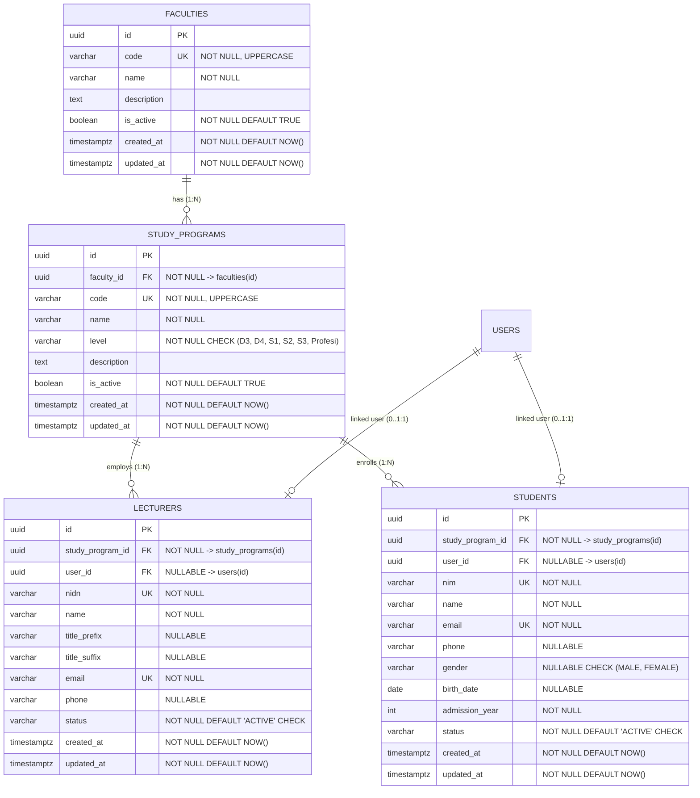

# Dokumentasi Database: Data Master Akademik (Fase 06)

Modul Data Master Akademik merupakan fondasi data institusi perguruan tinggi pada sistem **EduCore**. Dokumen ini merinci skema tabel, relasi, constraint, indeks, serta strategi integritas data untuk entitas Fakultas, Program Studi, Dosen, dan Mahasiswa.

---

## 1. Diagram Relasi Entitas (ERD)

---

## 2. Struktur Tabel dan Kamus Data

### 2.1. Tabel `faculties` (Fakultas)

Menyimpan data unit pengelola akademik tingkat fakultas.

| Kolom | Tipe Data | Nullable | Default | Keterangan |
|---|---|---|---|---|
| `id` | `UUID` | No | `gen_random_uuid()` | Primary key |
| `code` | `VARCHAR(20)` | No | - | Kode unik fakultas (disimpan UPPERCASE, misal: `FT`, `FIK`, `FEB`) |
| `name` | `VARCHAR(255)` | No | - | Nama lengkap fakultas |
| `description` | `TEXT` | Yes | `NULL` | Keterangan atau profil fakultas |
| `is_active` | `BOOLEAN` | No | `TRUE` | Status operasional fakultas |
| `created_at` | `TIMESTAMPTZ` | No | `NOW()` | Waktu pembuatan record |
| `updated_at` | `TIMESTAMPTZ` | No | `NOW()` | Waktu pembaruan terakhir record |

**Constraint & Indeks:**
- PK: `faculties_pkey` (`id`)
- Unique: `faculties_code_key` (`code`)
- Indexes:
  - `idx_faculties_code` (`code`)
  - `idx_faculties_is_active` (`is_active`)

---

### 2.2. Tabel `study_programs` (Program Studi)

Menyimpan data program studi di bawah naungan fakultas.

| Kolom | Tipe Data | Nullable | Default | Keterangan |
|---|---|---|---|---|
| `id` | `UUID` | No | `gen_random_uuid()` | Primary key |
| `faculty_id` | `UUID` | No | - | Referensi ke `faculties(id)` (`ON DELETE RESTRICT`) |
| `code` | `VARCHAR(20)` | No | - | Kode unik prodi (disimpan UPPERCASE, misal: `TIF`, `SI`, `ARS`) |
| `name` | `VARCHAR(255)` | No | - | Nama program studi |
| `level` | `VARCHAR(20)` | No | - | Jenjang pendidikan: `D3`, `D4`, `S1`, `S2`, `S3`, `Profesi` |
| `description` | `TEXT` | Yes | `NULL` | Deskripsi program studi |
| `is_active` | `BOOLEAN` | No | `TRUE` | Status aktif operasional prodi |
| `created_at` | `TIMESTAMPTZ` | No | `NOW()` | Waktu record dibuat |
| `updated_at` | `TIMESTAMPTZ` | No | `NOW()` | Waktu record diperbarui |

**Constraint & Indeks:**
- PK: `study_programs_pkey` (`id`)
- FK: `fk_study_programs_faculty` -> `faculties(id)` (`ON DELETE RESTRICT`)
- Unique: `study_programs_code_key` (`code`)
- Check: `chk_study_programs_level` -> `level IN ('D3', 'D4', 'S1', 'S2', 'S3', 'Profesi')`
- Indexes:
  - `idx_study_programs_faculty_id` (`faculty_id`)
  - `idx_study_programs_code` (`code`)
  - `idx_study_programs_level` (`level`)
  - `idx_study_programs_is_active` (`is_active`)

---

### 2.3. Tabel `lecturers` (Dosen)

Menyimpan profil dosen institusi yang terikat pada program studi dan secara opsional terhubung ke akun login pengguna.

| Kolom | Tipe Data | Nullable | Default | Keterangan |
|---|---|---|---|---|
| `id` | `UUID` | No | `gen_random_uuid()` | Primary key profil dosen |
| `study_program_id` | `UUID` | No | - | Homebase prodi (`ON DELETE RESTRICT`) |
| `user_id` | `UUID` | Yes | `NULL` | Tautan akun pengguna (`ON DELETE SET NULL`) |
| `nidn` | `VARCHAR(20)` | No | - | Nomor Induk Dosen Nasional (unik) |
| `name` | `VARCHAR(255)` | No | - | Nama asli dosen |
| `title_prefix` | `VARCHAR(50)` | Yes | `NULL` | Gelar depan (contoh: `Prof. Dr. Ir.`) |
| `title_suffix` | `VARCHAR(100)` | Yes | `NULL` | Gelar belakang (contoh: `M.Kom., Ph.D.`) |
| `email` | `VARCHAR(255)` | No | - | Email dosen (unik, lowercase) |
| `phone` | `VARCHAR(50)` | Yes | `NULL` | Nomor kontak |
| `status` | `VARCHAR(20)` | No | `'ACTIVE'` | Status kepegawaian: `ACTIVE`, `INACTIVE`, `LEAVE` |
| `created_at` | `TIMESTAMPTZ` | No | `NOW()` | Waktu pembuatan |
| `updated_at` | `TIMESTAMPTZ` | No | `NOW()` | Waktu pembaruan |

**Constraint & Indeks:**
- PK: `lecturers_pkey` (`id`)
- FK: `fk_lecturers_study_program` -> `study_programs(id)` (`ON DELETE RESTRICT`)
- FK: `fk_lecturers_user` -> `users(id)` (`ON DELETE SET NULL`)
- Unique: `lecturers_nidn_key` (`nidn`), `lecturers_email_key` (`email`), `lecturers_user_id_key` (`user_id` WHERE `user_id IS NOT NULL`)
- Check: `chk_lecturers_status` -> `status IN ('ACTIVE', 'INACTIVE', 'LEAVE')`
- Indexes:
  - `idx_lecturers_study_program_id` (`study_program_id`)
  - `idx_lecturers_nidn` (`nidn`)
  - `idx_lecturers_name` (`name`)
  - `idx_lecturers_status` (`status`)

---

### 2.4. Tabel `students` (Mahasiswa)

Menyimpan profil mahasiswa terdaftar dalam program studi.

| Kolom | Tipe Data | Nullable | Default | Keterangan |
|---|---|---|---|---|
| `id` | `UUID` | No | `gen_random_uuid()` | Primary key |
| `study_program_id` | `UUID` | No | - | Program studi mahasiswa (`ON DELETE RESTRICT`) |
| `user_id` | `UUID` | Yes | `NULL` | Tautan akun login (`ON DELETE SET NULL`) |
| `nim` | `VARCHAR(30)` | No | - | Nomor Induk Mahasiswa (unik) |
| `name` | `VARCHAR(255)` | No | - | Nama lengkap mahasiswa |
| `email` | `VARCHAR(255)` | No | - | Email kontak / institusi (unik) |
| `phone` | `VARCHAR(50)` | Yes | `NULL` | Nomor telepon |
| `gender` | `VARCHAR(10)` | Yes | `NULL` | Jenis kelamin: `MALE`, `FEMALE` |
| `birth_date` | `DATE` | Yes | `NULL` | Tanggal lahir (format YYYY-MM-DD) |
| `admission_year` | `INT` | No | - | Tahun angkatan masuk (contoh: 2026) |
| `status` | `VARCHAR(20)` | No | `'ACTIVE'` | Status akademik: `ACTIVE`, `INACTIVE`, `PROBATION`, `GRADUATED`, `DROPOUT`, `SUSPENDED` |
| `created_at` | `TIMESTAMPTZ` | No | `NOW()` | Waktu pembuatan |
| `updated_at` | `TIMESTAMPTZ` | No | `NOW()` | Waktu pembaruan |

**Constraint & Indeks:**
- PK: `students_pkey` (`id`)
- FK: `fk_students_study_program` -> `study_programs(id)` (`ON DELETE RESTRICT`)
- FK: `fk_students_user` -> `users(id)` (`ON DELETE SET NULL`)
- Unique: `students_nim_key` (`nim`), `students_email_key` (`email`), `students_user_id_key` (`user_id` WHERE `user_id IS NOT NULL`)
- Check: `chk_students_status` -> `status IN ('ACTIVE', 'INACTIVE', 'PROBATION', 'GRADUATED', 'DROPOUT', 'SUSPENDED')`
- Check: `chk_students_gender` -> `gender IN ('MALE', 'FEMALE')`
- Indexes:
  - `idx_students_study_program_id` (`study_program_id`)
  - `idx_students_nim` (`nim`)
  - `idx_students_name` (`name`)
  - `idx_students_admission_year` (`admission_year`)
  - `idx_students_status` (`status`)

---

## 3. Kebijakan Integritas Relasi dan Penghapusan Data

1. **Anti-Cascading Delete (`ON DELETE RESTRICT`)**:
   - `faculties` tidak dapat dihapus jika masih direferensikan oleh tabel `study_programs`.
   - `study_programs` tidak dapat dihapus jika masih direferensikan oleh `lecturers` atau `students`.
   - Perubahan status operasional entitas induk tidak boleh menghapus histori akademik yang sudah ada.
2. **Keterkaitan Akun Pengguna (`ON DELETE SET NULL`)**:
   - Jika akun login pada tabel `users` dihapus atau dinonaktifkan, profil akademik mahasiswa/dosen tetap dipertahankan dengan `user_id` diset ke `NULL`. Hal ini mencegah hilangnya rekam jejak akademik institusi.
3. **Pemisahan Status Akun dan Status Akademik**:
   - Status akun login (`users.is_active`) adalah status autentikasi/akses aplikasi.
   - Status akademik (`students.status` / `lecturers.status`) adalah status legalitas akademik institusi (misal: `SUSPENDED`, `LEAVE`, `GRADUATED`). Keduanya dikelola secara independen.
